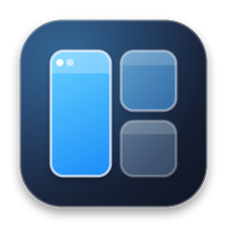

<p align="center">
  
</p>

<h1 align="center">Vetra</h1>

<p align="center">
  <strong>Intelligent Automatic Window Tiling & Live Dock Previews for macOS</strong>
</p>

<p align="center">
  
  
  
  
</p>

---

**Vetra** (from Italian *vetrata* — architectural glass panes) is a fast, lightweight, native macOS window manager and Dock preview utility built with **Swift 6** and **AppKit/SwiftUI**. It arranges your open windows automatically as they appear, lets you resize split dividers in real time, and brings live thumbnail previews to both the macOS Dock and stacked window tiles.

---

## ✨ Key Features

### 🪟 Dynamic Automatic Tiling Engine
- **4 Adaptive Layouts per Display:**
  - **Side (Master + Stack):** Keeps your primary window on the left (or top on portrait monitors) and stacks secondary windows on the right. Drag additional windows to the left pane to create multi-master splits.
  - **Grid:** Balanced $2 \times 2$ quad grid (expands up to 5 tiles automatically on Ultrawide displays with aspect ratio $\ge 21:9$).
  - **Columns:** Side-by-side vertical columns.
  - **Rows:** Stacked horizontal rows.
- **Per-Screen Capacity Control (`1..4`):** Choose the maximum number of visible tiles per monitor right from the menu bar matrix; extra windows automatically stack into the active tile.
- **Smart Gaps:** Automatically removes outer screen margins and inner gaps when only a single window is open on a display.
- **Minimum Size Constraint Solver:** Respects each window's `AXMinimumSize`, dynamically shifting split dividers or floating non-conforming windows so layouts never overlap.

### 🖼️ Live Dock & Stack Window Previews
- **Dock Hover Previews (Windows Taskbar / DockDoor Style):** Hover over any running app icon in the macOS Dock to see all open and minimized windows with live high-resolution window thumbnails, ambient frosted-glass backdrops, window count badges, and quick **Minimize/Restore (`−`)** and **Close (`×`)** buttons.
- **Zero Menu Bar Clutter:** Uses on-demand CoreGraphics window snapshots (`CGWindowListCreateImage`) strictly when hovering, avoiding the persistent purple Screen Sharing indicator in the macOS Menu Bar.
- **Bottom-Anchored Stack Tab Bar:** When a tile holds multiple stacked windows, a sleek tab bar at the bottom-center of the tile lets you switch windows with one click or preview hidden windows on hover without covering browser tabs.

### ⚡ Non-Intrusive On-Window Quick Untile Handle
- **Micro-Notch Border Handle (`48 × 7 pt`):** Sits directly on the outer border line of the active window so it **never blocks Google Chrome tabs or IDE toolbar buttons**.
- **Hover-to-Expand:** Hover over the border notch (or hold `⌥ Option`) to reveal one-click actions:
  - **Float / Tile Window (`⌃⌥W`):** Detach just the active window from tiling or snap it back into the grid.
  - **Ignore / Include App (`⌃⌥I`):** Exclude or re-include the entire application.
  - **Draggable & Flippable (`⇅`):** Drag horizontally along the window border or flip between the top and bottom border edges.

### 🎛️ Interactive Split Dividers & Workspace Modes
- **Live Divider Dragging:** Hover over the gap between tiled windows to reveal a glowing pill handle with native resize cursors (`columnResize` / `rowResize`), or resize any window edge directly.
- **Focus Mode (`⌃⌥F`):** Dims background windows and hides borders so you can focus on the active window.
- **Clean Space:** Automatically hides background tiled apps that are not part of the visible layout.
- **No Peek Mode:** Keeps tiled windows aligned and raised together when switching between tiled apps.
- **Bilingual UI:** Full support for **English (`EN`)** and **Turkish (`TR`)** switchable with a single click in the unified control center.

---

## ⌨️ Default Keyboard Shortcuts

All shortcuts can be customized or reset in the **Keyboard Shortcuts** drawer inside Vetra's menu bar panel:

| Action | Default Shortcut |
| :--- | :--- |
| **Float / Re-tile Active Window** | `⌃ ⌥ W` (`Ctrl + Option + W`) |
| **Ignore / Include Active App** | `⌃ ⌥ I` (`Ctrl + Option + I`) |
| **Pause / Resume Tiling** | `⌃ ⌥ T` (`Ctrl + Option + T`) |
| **Cycle Stacked Windows** | `⌃ ⌥ Space` |
| **Toggle Focus Mode** | `⌃ ⌥ F` |
| **Switch to Grid Layout** | `⌃ ⌥ 1` |
| **Switch to Columns Layout** | `⌃ ⌥ 2` |
| **Switch to Rows Layout** | `⌃ ⌥ 3` |
| **Switch to Side Layout** | `⌃ ⌥ 4` |
| **Swap Window (Left / Right / Up / Down)** | `⌃ ⌥ ←` / `→` / `↑` / `↓` |
| **Move Window to Another Display** | `⌃ ⌥ ⇧ ←` / `→` / `↑` / `↓` |

---

## 📦 Installation

### Option 1: Install via Disk Image (`Vetra.dmg`)
1. Download the latest **`Vetra.dmg`** from [GitHub Releases](https://github.com/yourusername/vetra/releases).
2. Open **`Vetra.dmg`** and drag **`Vetra.app`** into your **`Applications`** folder.
3. Launch **Vetra** from `/Applications` or Spotlight.

> **macOS Security Note (Gatekeeper):**  
> If macOS displays a message saying *"Vetra cannot be opened because Apple cannot check it for malicious software"*, open **System Settings → Privacy & Security**, scroll down to the **Security** section, and click **Open Anyway**.

### Option 2: Install via Homebrew Cask
```bash
brew tap yourusername/vetra
brew install --cask vetra
```

### Option 3: Build from Source
Requirements: **macOS 15.0+** and **Swift 6.0+** (Xcode 16+ or Command Line Tools).

```bash
# Clone the repository
git clone https://github.com/yourusername/vetra.git
cd vetra

# Run unit tests
swift test

# Build Release Vetra.app bundle, generate AppIcon.icns, and package Vetra.dmg
./build_app.sh

# Launch Vetra
open Vetra.app
```

---

## 🔐 System Permissions

Vetra requires two standard macOS permissions, both manageable directly inside the **Permissions & General** section of the menu bar control panel:

1. **Accessibility (`Required`):** Allows Vetra to observe window lifecycle events and position/resize windows via the macOS Accessibility API (`AXUIElement`).
2. **Screen Recording (`Optional — for Live Previews`):** Allows Vetra to render live window thumbnails inside Dock hover previews and stacked window tabs. After enabling Screen Recording in **System Settings → Privacy & Security → Screen & System Audio Recording**, click the **Restart (`↻`)** button in Vetra's permissions panel.

---

## 🏗️ Project Architecture

```text
.
├── Info.plist                    # App bundle metadata & permission usage descriptions
├── Package.swift                 # Swift 6.0 package manifest
├── build_app.sh                  # Icon generator, Release app bundler, codesigner & DMG packager
├── scripts/
│   └── generate_icons.swift      # CoreGraphics 3D glass squircle icon & AppIcon.icns generator
├── Assets/
│   ├── AppIcon.icns              # Compiled multi-resolution macOS application icon
│   └── logo.png                  # High-resolution Vetra brand mark
├── Sources/Vetra/
│   ├── VetraApp.swift            # App lifecycle, MenuBarExtra & custom MenuBarBrandIcon
│   ├── Core/
│   │   ├── LayoutEngine/         # Pure geometry layout calculator & minimum-size solver
│   │   ├── Accessibility/        # AXWindowService, WindowObserver, WindowFilter & TilingCoordinator
│   │   ├── System/               # ScreenManager, StageManagerDetector, HotkeyManager & WindowSnapshotService
│   │   └── Storage/              # SettingsStore, ShortcutAction & 3D AppIconArtworkView
│   └── UI/
│       ├── MenuBarView.swift     # MenuBarExtra root & style card components
│       ├── SettingsView.swift    # Unified single-menu Control Center
│       ├── BorderOverlayManager.swift # Glow borders, live dividers, stack tabs & border micro-notch
│       ├── DockHoverPreviewManager.swift # Live macOS Dock hover window preview panels
│       └── Localization.swift    # English (EN) & Turkish (TR) localization catalog
└── Tests/VetraTests/
    └── LayoutEngineTests.swift   # Suite of 12 geometry, constraint & state unit tests
```

---

## 📄 License

Released under the [MIT License](LICENSE).